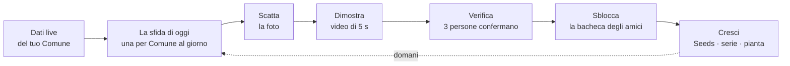
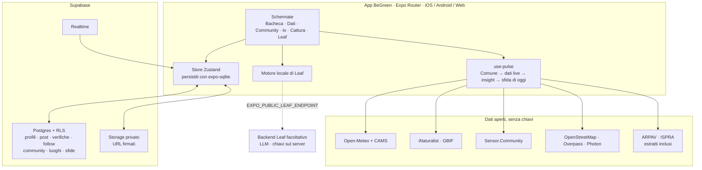

<div align="center">

<picture>
  <source media="(prefers-color-scheme: dark)" srcset="docs/readme/brand/begreen-lockup-reverse-lime-on-canopy.svg">
  
</picture>

### Love your city. Show it.

**Fotografa un gesto green, dimostralo in 5 secondi, fallo verificare dagli amici, partendo dai dati ambientali live del tuo Comune.**

<sub><a href="README.md">English</a> · <b>Italiano</b></sub>

<br>

[](docs/regolamento.md)
[](docs/traccia.md)
[](#team)
[](https://github.com/xFurti/BeGreen/actions/workflows/ci.yml)

[](https://docs.expo.dev/versions/v58.0.0/)
[](https://reactnative.dev)
[](https://react.dev)
[](https://www.typescriptlang.org)
[](https://supabase.com)
[](https://www.openstreetmap.org)


<br>

[Perché](#perché-begreen) ·
[Come funziona](#come-funziona) ·
[Funzioni](#funzioni) ·
[La traccia](#costruita-sulla-traccia) ·
[Dati e AI](#dati-aperti-e-ai) ·
[Avvio](#avvio) ·
[Architettura](#architettura) ·
[Brand](#brand-e-design-system) ·
[Limiti](#limiti-dichiarati) ·
[Team](#team)

<br>


</div>

---

## Perché BeGreen

> Le persone non dovrebbero aprire BeGreen perché hanno a cuore la sostenibilità. Lo aprono perché è **divertente, social e dà loro qualcosa da condividere**. La sostenibilità è ciò che rende l'esperienza significativa, e diversa.

La sostenibilità sembra sempre una questione di altri: governi, aziende, scienziati. Ai ragazzi non manca la consapevolezza sul clima; sono stanchi di catastrofismo, sensi di colpa e adulti che ostentano virtù online. Quello che manca è un **modo piccolo, social e visibile per agire**, che parta da *dove vivi*.

«Oggi a Schio l'aria è scadente» colpisce più di «il pianeta si scalda». BeGreen prende i dati ambientali live del tuo Comune, li trasforma in **un'unica sfida quotidiana condivisa** e fa del gesto il biglietto d'ingresso per vedere cosa hanno fatto i tuoi amici.

<table>
<tr>
<td width="33%" valign="top">

<br>
**Prove, non promesse**<br>
Una foto più un video di 5 secondi, verificati da tre persone. Niente greenwashing, nemmeno con te stesso.

</td>
<td width="33%" valign="top">

<br>
**Locale e reale**<br>
Ogni sfida nasce dalle misure di oggi nel tuo Comune: aria, pioggia, suolo, natura, con le loro fonti.

</td>
<td width="33%" valign="top">

<br>
**La tua città, vista dalla tua community**<br>
Riparatori, punti di ricarica, orti, eventi e segnalazioni su una mappa reale, costruita da chi ci vive.

</td>
</tr>
</table>

## Come funziona



| | Passo | Cosa succede |
| :---: | --- | --- |
|  | **La sfida di oggi** | Ogni giorno tutti in un Comune ricevono **la stessa sfida**, generata dai dati live di quel Comune e salvata sul backend condiviso. Aria scadente → *Lascia l’auto. La strada è tua.* A differenza di BeReal non c'è una sveglia casuale: pubblichi quando lo fai davvero. |
|  | **Scatta** | Una foto della cosa: la bici, il bidone, la borraccia, la pianta. |
|  | **Dimostra** | Un video di 2–5 secondi del gesto, riprodotto dentro la foto in un riquadro. |
|  | **Verifica** | Chi può vedere la tua prova (il tuo Comune o il gruppo scelto) la controlla. **3 verifiche** la rendono *Verificata*. Non puoi verificare la tua. |
|  | **Pubblica la tua per vedere le loro** | La bacheca di oggi resta sfocata finché non hai fatto il tuo gesto green. |
|  | **Cresci** | Seeds, una serie di giorni, obiettivi dell'Agenda 2030 e una pianta che cresce dal seme al fiore. Mai una classifica in faccia. |

## Funzioni

<table>
<tr>
<td width="25%" align="center"><br><sub><b>Pianta il tuo seme</b></sub></td>
<td width="25%" align="center"><br><sub><b>Bacheca</b></sub></td>
<td width="25%" align="center"><br><sub><b>La sfida di oggi</b></sub></td>
<td width="25%" align="center"><br><sub><b>Scatta → Dimostra</b></sub></td>
</tr>
<tr>
<td width="25%" align="center"><br><sub><b>Dati del territorio</b></sub></td>
<td width="25%" align="center"><br><sub><b>Spiegato per me, la classe, il Comune</b></sub></td>
<td width="25%" align="center"><br><sub><b>Leaf: risposte con le fonti</b></sub></td>
<td width="25%" align="center"><br><sub><b>Community: territorio</b></sub></td>
</tr>
<tr>
<td width="25%" align="center"><br><sub><b>Una mappa costruita dalla community</b></sub></td>
<td width="25%" align="center"><br><sub><b>Gruppi: classi, amici, crew</b></sub></td>
<td width="25%" align="center"><br><sub><b>Io: pianta, impatto, Agenda 2030</b></sub></td>
<td width="25%" align="center"><br><sub><b>Come si fa e dove si butta</b></sub></td>
</tr>
</table>

<sub>Le schermate mostrano l'interfaccia in inglese; l'app è completamente in italiano su un dispositivo in italiano.</sub>

###  Pianta il tuo seme (onboarding)

Il tuo seme, un piccolo compagno con una faccia, chiede una cosa alla volta: dove piantarlo (la tua posizione o una ricerca), poi mostra **il terreno live di quel Comune** (aria, pioggia o giorni secchi, umidità del suolo, ognuno con la sua fonte) e ci reagisce, mentre la sfida di oggi si apre come un bocciolo. Poi nome, @nome utente (controllato mentre scrivi, con alternative libere), ruolo (studente, docente, associazione, Comune) e specie (girasole, quercia, lavanda, papavero, pomodoro, abete). *Tieni premuto per piantare* crea un account anonimo: niente email, niente password. Il permesso della fotocamera viene spiegato prima che il telefono lo chieda. Con Riduci movimento le animazioni diventano dissolvenze; per gli screen reader basta un tocco.

###  Bacheca

Una scheda del giorno con la sfida di oggi, il conto alla rovescia, la tua serie, quante persone del tuo Comune l'hanno già fatta e la tua prova (con l'avanzamento delle verifiche), poi l'accesso alla Community. Filtri: **Tutto · Amici · Gruppi · il tuo Comune**. Le prove di gruppo compaiono solo nel gruppo in cui sono state condivise. Quando un Comune è ancora silenzioso, prove d'esempio riempiono la bacheca, sempre marcate **DEMO**, mai verificabili né conteggiate. I tuoi post hanno un menu **⋯** per eliminarli ovunque.

###  Cattura: Scatta → Dimostra → Rivedi → Festeggia

Foto, poi una prova di 2–5 secondi, poi la revisione. Scegli dove va: **il tuo Comune, Tutti o un gruppo** (se il gruppo manca l'invio si blocca invece di pubblicare altrove). La festa finale mostra Seeds, serie, contributo e obiettivi dell'Agenda 2030, più il nuovo stadio della pianta se il seme è cresciuto. Su simulatore o sul web non c'è fotocamera, quindi la cattura da **galleria** e **demo** permette di provare tutto il flusso.

###  Dati del tuo Comune

Sei schede compatte (**aria, meteo, pioggia, suolo, osservazioni di piante, aree protette**). Ognuna apre un dettaglio con grafici animati e selezionabili, foto o aree vicine, spiegazioni **Io / La mia classe / Comune**, fonti e limiti, e l'azione collegata. Ogni fonte si carica separatamente, così un disservizio non svuota mai la schermata; le fonti mancanti restano visibili con un pulsante per riprovare.

###  Leaf: l'assistente che cita le fonti

Leaf si apre con una riga su com'è oggi il tuo Comune, i numeri di oggi come chip e fino a tre domande scelte dai dati (prima i problemi). Ogni risposta è una scheda: un verdetto, una breve spiegazione, i numeri, **le fonti usate** e se è una risposta guidata o AI. *Spiegato per* passa da Io a La mia classe al Comune; i chip di seguito ripetono la domanda per un altro pubblico. Non inventa mai un valore. [Di più su Leaf ↓](#leaf-il-livello-ai)

###  Community: territorio, gruppi, classifiche

- **Territorio:** il Comune scelto, una grande anteprima della mappa a schermo intero, le persone del posto e i contributi recenti.
- **La mappa è reale:** OpenStreetMap fino al livello della strada, con i segnaposto BeGreen in sette livelli: *scopri, ripara e riusa, orti e gruppi, scambia e condividi, eventi e sfide, segnalazioni, momenti*. La ricerca capisce le domande («Dove posso riparare una bici?», «eventi questo weekend») e trova vie reali; filtri, legenda, raggruppamento e indicazioni stradali.
- **Aggiungi un luogo** in cinque passi partendo dalla foto (cosa, foto, parole, dove, chi lo vede). I punti pubblici esatti richiedono una conferma esplicita; qualsiasi punto può essere approssimato (~200 m).
- **Strumenti di fiducia:** segnalazioni «non aggiornato», «sbagliato», «non va bene» e «sembra risolto», correzioni, blocco dell'autore, moderatori che verificano, nascondono o eliminano. La posizione in tempo reale di nessuno viene mai mostrata.
- **Gruppi** per amici, classi, associazioni e crew: pubblici o privati, si entra con un codice invito. Ogni gruppo ha obiettivi, un report d'impatto in un grande numero (kg CO₂e evitati, gesti, oggetti) e la classifica settimanale nella pagina.
- **Sfide** con un obiettivo e una scadenza (scopri 5 luoghi, organizza uno scambio, pulisci un angolo trascurato…), un elenco di ringraziamenti invece di una classifica, più una **domanda del giorno** facoltativa per tutti, senza serie.
- **Classifiche** secondarie e facoltative: il Comune o uno dei tuoi gruppi, dalle prove recenti, dichiarate come campione.

###  Amici

Segui chi vuoi: gli account che segui sono i tuoi amici. I profili mostrano Segui / Segui già / Ricambia, i contatori e una griglia di foto. Ricerca per nome o @nome utente, con suggerimenti dai tuoi gruppi e dal tuo Comune. Le prove degli amici compaiono nel filtro *Amici* e nel filtro «dagli amici» della mappa.

###  Io

La pianta del tuo seme (seme → germoglio → piantina a 60 Seeds → pianta a 200 → fioritura a 500; non rimpicciolisce mai, sembra solo assetata quando la serie si interrompe), serie, Seeds, prove verificate, follower. Tre schede:

- **Impatto:** stime di kg CO₂e, oggetti, litri e osservazioni naturalistiche (sempre dichiarate come stime), la griglia dell'**Agenda 2030** con il conto alla rovescia al 1° gennaio 2030 e sei **badge** con anello di avanzamento, uno dei quali si può indossare come titolo.
- **Foto:** la griglia delle tue prove.
- **Mappa:** le zone delle tue prove (il centro del Comune, mai il punto esatto).

Impostazioni: modifica profilo e seme, tema chiaro / scuro / di sistema, pubblico delle spiegazioni, Comune, **italiano / inglese**, luoghi salvati, guida, fonti, Leaf.

###  Come si fa e Come lo sappiamo

- **Come si fa:** una scheda per ognuno dei dieci gesti green con una guida facoltativa in tre passi, e una ricerca **«Dove va?»** per sei materiali con esempi.
- **Come lo sappiamo:** cos'è ogni tipo di fonte (ufficiale, modello, citizen science, mappa aperta, community), a cosa serve e dove fare attenzione. I dati con accesso o licenza ancora da verificare sono segnati con ⚠︎.

### I dieci gesti green

| Gesto | Ambiti | Agenda 2030 | Impatto stimato |
| --- | --- | --- | --- |
|  Senza auto | mobilità, aria | SDG 11 · 13 · 3 | 0,8 kg CO₂e |
| Differenziata giusta | consumi, suolo | SDG 12 · 11 | 1 oggetto |
|  Rifiuti raccolti | suolo, acqua, natura | SDG 14 · 15 · 11 | 5 oggetti |
| Ricarica, non discarica | consumi, acqua | SDG 12 · 6 | 1 oggetto |
|  Pianta qualcosa | suolo, natura, aria | SDG 15 · 13 | 0,25 m² |
| Osserva una pianta | natura | SDG 15 · 14 | 1 osservazione |
| Piatto zero sprechi | consumi | SDG 12 · 2 · 13 | 0,5 kg CO₂e |
| Usato / riparato | consumi | SDG 12 · 8 | 1 oggetto |
| Risparmia acqua / energia | acqua, aria | SDG 6 · 7 · 13 | 20 litri |
| Azione di squadra | comunità | SDG 17 · 11 · 4 | 10 oggetti |

<sub>Gli impatti sono stime prudenti per gesto (`src/data/actions.ts`) e nell'app sono sempre dichiarati come tali.</sub>

## Costruita sulla traccia

BeGreen risponde alla **traccia 2, «La mia sostenibilità»** dell'hackathon civico [Good Vibes / FESAV 2026](docs/regolamento.md). La domanda guida: *come trasformiamo i dati ambientali del nostro territorio in decisioni e azioni alla portata di chi le deve prendere?*

| Richiesta della traccia | Dove si trova in BeGreen |
| --- | --- |
| Scala persona / classe / associazione / Comune | Ruoli nell'onboarding, tipi di gruppo, spiegazioni **Io / La mia classe / Comune** in Dati e Leaf |
| Partire dall'ambiente locale | Dati e la sfida di oggi, dal Comune scelto dall'utente (il GPS lo suggerisce soltanto) |
| Collegare il sapere al fare | Ogni scheda dei Dati termina con un'azione; la sfida di oggi trasforma l'indicatore peggiore del giorno in una missione |
| Aria, acqua, suolo, biodiversità, consumi, mobilità, comunità | Sei schede Dati e dieci gesti, ognuno con gli ambiti che tocca |
| Aree protette, specie, osservazioni naturalistiche | Specie da iNaturalist e GBIF con foto e attribuzione; aree protette da OpenStreetMap |
| Qualità dell'aria, meteo, clima locale | Indice europeo CAMS con grafico 24 h e inquinante dominante, sensori PM2.5 dei cittadini, stazioni PM10 ARPAV, meteo e pioggia |
| Suolo e paesaggio | Umidità del suolo e andamento; consumo di suolo ISPRA per Comune |
| Comportamenti individuali e attività di gruppo | Prove personali, obiettivi e impatto dei gruppi, sfide della community |
| AI per capire misure e documenti | **Leaf** spiega i numeri in linguaggio semplice e si collega a un backend LLM |
| Risposte con citazione delle fonti | Ogni risposta di Leaf e ogni scheda Dati riporta le proprie fonti |
| Interpretazione delle immagini | Prove foto + video verificate dalle persone oggi; il contratto del backend prevede riconoscimento di specie e controllo delle prove |
| Le fonti non sono equivalenti | Cinque tipi di fonte con colori distinti; ogni scheda dichiara i propri limiti (es. «modello, griglia ~10 km, non una stazione ARPA») |
| Agenda 2030 | Ogni gesto e ogni scheda Dati riporta gli SDG che tocca; il profilo conta gli obiettivi coperti |

### Rispetto ai criteri della giuria

| Criterio | La nostra risposta |
| --- | --- |
|  **Coerenza** | Un unico ciclo dai dati aperti locali a un gesto concreto, verificato da persone reali, alla scala di una persona, una classe, un'associazione o un Comune. |
|  **Innovatività** | Non una dashboard ecologica: un social la cui moneta sono i gesti green verificati. Una sfida condivisa per Comune al giorno, video di prova, verifica tra pari, una mappa costruita dalla community, un assistente che cita le fonti. |
|  **Sostenibilità reale** | Nessuna chiave API e nessun dato a pagamento: fonti aperte più Expo e Supabase. Crescita città per città e scuola per scuola; gratis per i ragazzi, con un piano a pagamento per scuole e Comuni e sfide sponsorizzate solo da partner verificati e per gesti verificabili ([MARKETING.md](MARKETING.md)). L'impatto si conta in gesti verificati, mai gonfiato. |

## Dati aperti e AI

### Fonti dei dati: nessuna chiave API

| Ambito | Fonte | Tipo |
| --- | --- | --- |
| Qualità dell'aria (EAQI, PM2.5, PM10, NO₂, O₃, previsione 24 h) | Copernicus CAMS tramite Open-Meteo |  |
| Meteo, pioggia degli ultimi 7 giorni e dei prossimi 3, umidità del suolo | Open-Meteo |  |
| Specie osservate entro 10 km negli ultimi 30 giorni (research grade) | API iNaturalist |  |
| Specie registrate entro 5 km negli ultimi 5 anni | API GBIF |  |
| Sensori PM2.5 dei cittadini entro 10 km (mediana delle ultime letture) | Sensor.Community |  |
| Aree protette e riserve naturali entro 25 km | OpenStreetMap tramite Overpass |  |
| Comuni italiani (ricerca, coordinate) | Geocoding Open-Meteo (GeoNames) |  |
| Media annua PM10 e giorni di superamento per stazione (2025), emissioni per Comune (INEMAR 2019) | Open data ARPAV (estratto CSV incluso) |  |
| Suolo consumato per Comune (2024), raccolta differenziata per Comune (2024) | ISPRA / SNPA, Catasto Rifiuti ISPRA (estratto incluso) |  |
| Gesti, sfide, luoghi | BeGreen (aggregati, anonimi) |  |

I dati ufficiali per Comune sono un estratto incluso per la **Provincia di Vicenza**, abbinato al Comune scelto per nome (o per centroide più vicino). Dataset, join e soglie: [`docs/dati-comune.md`](docs/dati-comune.md). Se tutto è offline l'app mostra dati d'esempio chiaramente etichettati, e una sfida generata da dati d'esempio non viene mai salvata come sfida del Comune.

### Leaf: il livello AI

`src/services/leaf.ts` ha due modalità:

- **Motore locale ancorato ai dati (predefinito):** riconosce l'intento della domanda e risponde usando solo i numeri live dei Dati. Non inventa mai un valore, cita sempre le fonti e funziona offline, in italiano o in inglese.
- **Backend AI:** imposta `EXPO_PUBLIC_LEAF_ENDPOINT`. È su quel server che un modello linguistico legge documenti, interpreta le immagini delle prove, riconosce le specie e riscrive le risposte per il pubblico scelto. **Le chiavi dei modelli restano sul server, mai nell'app.** Se il backend non risponde, l'app torna al motore locale.

<details>
<summary><b>Contratto del backend di Leaf</b></summary>

<br>

L'app invia:

```json
POST { "question": "…", "audience": "me | class | comune", "language": "it | en", "pulse": { }, "insights": [ ] }
```

e si aspetta:

```json
{ "text": "…", "cites": ["cams", "openmeteo"], "headline": "…", "facts": [{ "label": "PM2.5", "value": 18, "unit": "µg/m³", "level": "fair" }], "followUps": ["…", "…"] }
```

`headline`, `facts` e `followUps` (fino a due) sono facoltativi; fonti sconosciute e campi malformati vengono scartati. Se il backend ignora `language`, risponde il motore locale nella lingua attiva.

</details>

## Avvio

> [!NOTE]
> Servono Node.js 24 (come in CI) e npm. L'app gira in **Expo Go**, per la demo non serve una build nativa.

```bash
git clone https://github.com/xFurti/BeGreen.git
cd BeGreen
npm install
npx expo start            # i = simulatore iOS · a = Android · inquadra il QR code con Expo Go
```

**Anteprima web locale senza backend** (tutto resta nel browser):

```bash
EXPO_NO_DOTENV=1 npm run web -- --port 8092
```

### Bacheca condivisa tra telefoni (Supabase)

1. Crea un progetto Supabase (o esegui `npx eas-cli@latest integrations:supabase:connect`), poi in **Authentication → Sign In / Providers** attiva **Allow anonymous sign-ins**.
2. Applica lo schema: `npx supabase link --project-ref <ref>` e `npx supabase db push`.
3. Copia `.env.example` in `.env.local` e compila i valori pubblici:

   | Variabile | Obbligatoria | Cosa |
   | --- | :---: | --- |
   | `EXPO_PUBLIC_SUPABASE_URL` | per condividere | URL del progetto (Project Settings → API) |
   | `EXPO_PUBLIC_SUPABASE_PUBLISHABLE_KEY` | per condividere | Publishable key, pubblica per natura: i dati sono protetti dalla RLS |
   | `EXPO_PUBLIC_LEAF_ENDPOINT` | facoltativa | Il tuo backend AI per Leaf |
   | `GOOGLE_MAPS_API_KEY` | facoltativa, in build | Chiave Maps SDK limitata per la mappa nativa del profilo su Android |

4. Riavvia `npx expo start`. Due telefoni (o un browser e una finestra privata) condividono la sfida di oggi, la bacheca, i gruppi e la mappa.

> [!IMPORTANT]
> Non inserire mai una chiave segreta o service-role nell'app. Senza le due variabili Supabase BeGreen funziona comunque, solo su questo telefono.

### Mappe

La mappa della community usa ovunque le tile OpenStreetMap e la ricerca Photon. La mappa del profilo usa **Expo Maps** in una development build (Apple Maps da iOS 18; Google Maps su Android con una chiave Maps SDK) e un'anteprima statica a tile in Expo Go. Dettagli: [`docs/profile.md`](docs/profile.md).

### Controlli

```bash
npm run verify            # typecheck + lint + test (workflow, i18n, servizi, migrazioni Supabase e RLS)
```

Lo stesso comando è il check `Verify` della CI. I test del database eseguono tutte le migrazioni su un Postgres in memoria ([PGlite](https://pglite.dev)) e verificano la row level security.

## Architettura



<details>
<summary><b>Backend condiviso: regole imposte dal database</b></summary>

<br>

- **Account** anonimi Supabase con nome e nome utente pubblici. Scrivi solo le tue righe, non puoi verificare la tua prova né riscattare due volte la stessa sfida; i totali dei gruppi li mantiene il database, non l'app. Eliminare un post elimina a cascata verifiche, reazioni e commenti.
- **La sfida di oggi** è una riga per Comune al giorno (`<id comune>:<data>`). Il primo telefono che apre l'app quel giorno la genera dai dati live del Comune; tutti gli altri leggono la stessa riga. Ogni telefono scrive il titolo nella propria lingua a partire dalle stesse misure salvate.
- **I media** stanno nel bucket privato `proofs`, una cartella per utente, letti tramite URL firmati di cinque minuti. Foto JPEG fino a 1280 px, clip a 480p quando supportato.
- **Aggiornamenti live:** la bacheca si aggiorna quando qualcuno pubblica, verifica, reagisce o commenta.
- **Community:** città e gruppi, luoghi, segnalazioni (con oscuramento automatico), salvataggi, eventi, sfide, blocchi e `join_by_code`, tutto con RLS.
- **Follow:** chiunque abbia effettuato l'accesso può leggerli; solo tu puoi aggiungere o togliere i tuoi.

Migrazioni: [`supabase/migrations`](supabase/migrations) · test: [`supabase/tests`](supabase/tests).

</details>

<details>
<summary><b>Migrazione delle vecchie squadre in gruppi</b></summary>

<br>

`20261028000000_unified_groups.sql` copia le squadre esistenti in gruppi privati con ID stabili `squad:<uuid>`, conserva iscrizioni, date di adesione, post e interazioni, e mantiene le vecchie tabelle. I vecchi codici invito restano validi come alias; i codici ambigui chiedono alla persona di scegliere. Il bucket `proofs` diventa privato, quindi **app e migrazione vanno rilasciate insieme dopo approvazione umana**, dopo una prova su una copia usa e getta. I test PGlite coprono Postgres/RLS, non il comportamento HTTP o CDN di Supabase Storage. I vecchi percorsi `/squad/:id`, `/new-squad` e `/league` reindirizzano alle nuove schermate.

</details>

<details>
<summary><b>Struttura del progetto</b></summary>

<br>

```
src/
  app/                     Rotte Expo Router (solo schermate)
    (tabs)/                Bacheca · Dati · Community · Io + tab bar con il pulsante di scatto
    onboarding.tsx         Pianta il tuo seme
    capture.tsx            Scatta → Dimostra → Rivedi → Festeggia
    drop.tsx               La sfida di oggi e le misure da cui nasce
    leaf.tsx               Assistente Leaf
    sources.tsx            Come lo sappiamo
    guide.tsx              Come si fa · Dove va?
    comune.tsx             Ricerca del Comune
    post/[id].tsx          Dettaglio della prova, verifiche, commenti
    friends.tsx member/[id].tsx    Follow, ricerca, profili
    community/[id].tsx     Pagina di città o gruppo · community-ranking.tsx
    map/[id].tsx spot/[id].tsx add-spot.tsx flag-spot.tsx saved.tsx
    communities.tsx new-community.tsx join.tsx new-challenge.tsx
    squad/[id].tsx new-squad.tsx league.tsx   Reindirizzamenti legacy
  components/              UI kit, logo, motivi naturali, schede, mappa, badge, onboarding, guida
  data/                    Gesti, badge, semi, SDG, fonti, guida ai rifiuti, Comuni, media demo
  hooks/                   use-pulse, use-social, use-comune, use-community-feed…
  i18n/                    Cataloghi italiano / inglese, rilevamento e salvataggio della lingua
  services/                env (API live), drop, challenge, leaf, social, community, follows, media…
  store/                   app-store e community-store (Zustand)
  theme/                   Token colore, famiglie Geist, raggi, scala tipografica
supabase/                  Migrazioni (schema, RLS, trigger, bucket) e relativi test
tests/                     Test unitari (badge, semi, ricompense, media, tema…)
assets/                    Icona, splash, foto demo (Unsplash), clip di prova da 5 s
docs/                      Traccia, regolamento, decisioni, note sui dati, schermate
```

</details>

## Brand e design system

<table>
<tr>
<td width="140" align="center"></td>
<td>


</td>
</tr>
</table>

<p align="center">
  
  &nbsp;&nbsp;
  
</p>

- **Carta bianca, inchiostro nero, un solo verde vivo.** Proof Lime e Canopy per logo, icona e splash; nell'app una famiglia di verdi (`forest`, `leaf`, `lime`, `mint`) in `src/theme/tokens.ts`. I dati mantengono i propri colori di segnale (fasce dell'aria, tipi di fonte, rosso della registrazione). Tema chiaro e scuro.
- **Logo:** il marchio con la «B» a foglia e il lockup del BeGreen Brand Kit v1.0, disegnati come vettori in `src/components/logo.tsx`. Mai lime su bianco (1,4:1), mai stirato, ruotato o ricomposto; minimo 88 px di larghezza per il lockup, 16 px di altezza per il marchio.
- **Caratteri:** Geist per titoli e testo, **Geist Mono** per metadati e numeri (`SDG 13`, `PROOF 0:05`). Il brand book aggiunge Funnel Display per i titoli di comunicazione.
- **Motivi naturali:** un germoglio per gli stati vuoti, forme organiche che fluttuano, un interruttore da cui spunta una foglia, foglie che volano quando verifichi, coriandoli di foglie nella festa finale. Decorativi e nascosti agli screen reader.
- **Sensazione:** impaginazione editoriale, linee sottili, grandi numeri tabulari, feedback aptico a ogni tocco importante, molle in entrata. Riduci movimento è rispettato ovunque.
- **Voce:** breve, asciutta, un po' ironica. Celebriamo il fare, non giudichiamo il non fare. Onesti sui dati: «modello», «stima», «citizen science».

## Strategia di lancio

<div align="center">
<picture>
  <source media="(prefers-color-scheme: dark)" srcset="docs/readme/brand/love_your_city_white.svg">
  
</picture>
</div>

La strategia è un percorso dallo scroll alla strada:

| | Fase | L'aggancio | In BeGreen |
| :---: | --- | --- | --- |
|  | **1. Farli entrare** | *«Finalmente la sostenibilità non è noiosa.»* Post divertenti e in cui riconoscersi, da mandare agli amici. | Canali social; prove condivisibili. Qualcuno scarica BeGreen senza nemmeno considerarsi un ambientalista. |
|  | **2. Il rito quotidiano** | *«Cosa hanno fatto tutti oggi?»* | La sfida di oggi, *pubblica la tua per vedere le loro*, la domanda del giorno. Saltare un giorno non è mai un fallimento. |
|  | **3. Il gioco nel mondo reale** | *«Vediamo cosa possiamo cambiare nella nostra città.»* | Gruppi, classi e quartieri affrontano sfide: un punto di riuso, una pulizia, un riparatore. |
|  | **4. La città diventa tua** | *«La tua città, vista con gli occhi della tua community.»* | La mappa della community: luoghi, eventi e segnalazioni scoperti tramite gli amici, non risultati sponsorizzati. |

La crescita è **scuola per scuola, città per città**, perché gli effetti di rete sono locali: scuole di lancio e ambassador studenti in una prima città, un Comune che presenta i risultati accanto ai dati reali sulla qualità dell'aria, poi la città successiva. Metrica guida: **gesti green verificati a settimana**. Piano completo, segmenti, metriche e modello di business: [MARKETING.md](MARKETING.md) (in inglese).

## Limiti dichiarati

> [!WARNING]
> Questo è un prototipo da hackathon. Ecco cosa non fa ancora.

- **Account anonimi** legati al telefono: uscendo o reinstallando si perde l'account (le prove restano in bacheca). Il collegamento a email / Apple / Google è nel backlog.
- **La sfida di oggi** la genera il primo telefono che apre l'app in un Comune quel giorno. Il database ne controlla forma e data, non i numeri; un job lato server la renderebbe a prova di manomissione.
- **La moderazione delle prove** è minima: «Segnala prova» chiede solo una conferma. I luoghi hanno segnalazioni, oscuramento automatico e moderatori, ma nominare moderatori oltre al fondatore di un gruppo si fa da database. Le verifiche sono una per persona, non ancora controllate per vicinanza o frodi.
- **Classifiche e conteggi** usano le prove scaricate, non aggregati completi lato server, e lo dichiarano.
- **Gli impatti** sono stime prudenti per gesto, dichiarate come tali.
- **La ricerca dei luoghi BeGreen** sulla mappa è un riconoscitore offline di parole chiave e intenti, non un modello linguistico. Tile e ricerca vie si appoggiano a servizi gratuiti OpenStreetMap / Photon pensati per un uso leggero; in produzione serve un fornitore di tile con chiave.
- **I dati ufficiali** (ARPAV, ISPRA) sono un estratto incluso per la Provincia di Vicenza; la licenza di riuso del Catasto Rifiuti ISPRA è ancora segnata «da verificare».

Idee per dopo l'hackathon: [`docs/ideas.md`](docs/ideas.md).

## Team

 **Magilla Gorilla**: sei studenti del **Liceo Tecnologico Guglielmo Marconi** di Verona, a **Good Vibes / FESAV 2026** (Schio, 22–24 ottobre 2026).

| Classe | Componenti |
| :---: | --- |
| **4AI** | Holovan Oleksii · Vitiello Lorenzo |
| **4BI** | Bassanello Leonardo · Cremonese Luca · Warnakulasuriya Arachchilage Fernando Nipun Samuel |
| **4SI** | Cipriani Gabriele |

## Come lavora il team

1. Leggi [AGENTS.md](AGENTS.md): vale anche per gli assistenti AI.
2. Attività e referenti in [docs/team.md](docs/team.md); le nuove idee in [docs/ideas.md](docs/ideas.md).
3. Crea un branch da `main` aggiornato (`feat/12-demo`, `fix/18-login`, `docs/pitch`) e apri una PR verso `main`. `npm run verify` deve passare.
4. Serve l'approvazione di un compagno di team prima del merge. Se la review Pi è configurata in CI, parte da sola sulle PR pronte.

| Documento | Cosa |
| --- | --- |
| [docs/traccia.md](docs/traccia.md) · [docs/regolamento.md](docs/regolamento.md) | Traccia ufficiale e regolamento dell'evento |
| [docs/decisions.md](docs/decisions.md) | Decisioni di prodotto e tecniche |
| [docs/presentation.md](docs/presentation.md) | Pitch e demo (8 minuti) |
| [docs/dati-comune.md](docs/dati-comune.md) | Dataset ufficiali per Comune |
| [MARKETING.md](MARKETING.md) | Piano di lancio |
| [skills/](skills/) | Skill facoltative per gli agenti: traccia, feature, review, pitch |

## Crediti

Dati ambientali da **Copernicus CAMS**, **Open-Meteo**, **iNaturalist**, **GBIF**, **Sensor.Community**, **ARPAV** e **ISPRA / SNPA**. Mappe © contributori di **OpenStreetMap** (ODbL), ricerca vie con **Photon** (komoot). Foto demo da **Unsplash**. Icone di questo README: **Ionicons** (MIT), lo stesso set usato dall'app. Micro-interazioni naturali ispirate a [uiverse.io](https://uiverse.io) e [React Bits](https://reactbits.dev).

<div align="center">
<br>

<br>
<sub><b>BeGreen</b> · Love your city. Show it. · Proof, not promises.</sub>
</div>
