<div align="center">

<picture>
  <source media="(prefers-color-scheme: dark)" srcset="docs/readme/brand/begreen-lockup-reverse-lime-on-canopy.svg">
  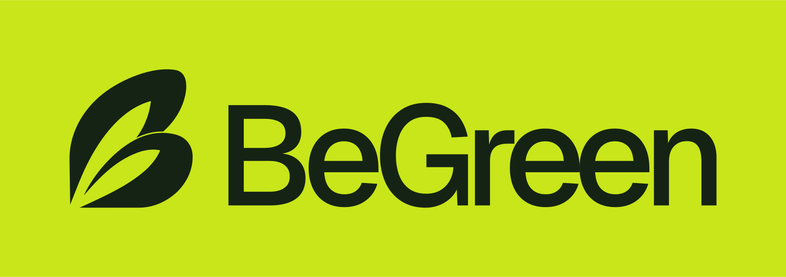
</picture>

### Love your city. Show it.

**Snap a green act, prove it in 5 seconds, let your friends verify it, all starting from your Comune's live environmental data.**

<sub><b>English</b> · <a href="README.it.md">Italiano</a></sub>

<br>

[](docs/regolamento.md)
[](docs/traccia.md)
[](#team)
[](https://github.com/xFurti/BeGreen/actions/workflows/ci.yml)

[](https://docs.expo.dev/versions/v58.0.0/)
[](https://reactnative.dev)
[](https://react.dev)
[](https://www.typescriptlang.org)
[](https://supabase.com)
[](https://www.openstreetmap.org)


<br>

[Why](#why-begreen) ·
[How it works](#how-it-works) ·
[Features](#features) ·
[The brief](#built-for-the-brief) ·
[Data & AI](#open-data--ai) ·
[Run it](#run-it) ·
[Architecture](#architecture) ·
[Brand](#brand--design-system) ·
[Limits](#honest-limits) ·
[Team](#team) ·
[Contributing](#contributing)

<br>

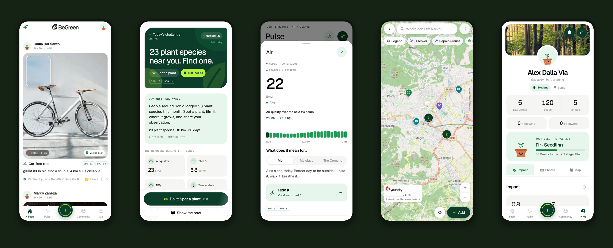

</div>

---

## Why BeGreen

> People shouldn't open BeGreen because they care about sustainability. They open it because it's **fun, social and gives them something to share**. Sustainability is what makes the experience meaningful, and different.

Sustainability usually feels like someone else's job: governments, companies, scientists. Teenagers aren't short on climate awareness; they're tired of doom, guilt and adults performing virtue online. What's missing is a **small, social and visible way to act**, one that starts from *where you live*.

“The air is poor in Schio today” hits harder than “the planet is warming”. BeGreen takes the live environmental data of your Comune, turns it into **one shared daily challenge**, and makes doing it the price of entry to see what your friends did.

<table>
<tr>
<td width="33%" valign="top">

<br>
**Proof, not promises**<br>
A photo plus a 5-second proof clip, verified by three people. No greenwashing, not even from yourself.

</td>
<td width="33%" valign="top">

<br>
**Local and real**<br>
Every challenge starts from today's measurements in your Comune: air, rain, soil, nature, with their sources.

</td>
<td width="33%" valign="top">

<br>
**Your city, through your community**<br>
Repair shops, refill points, gardens, events and reports on a real map, built by the people who live there.

</td>
</tr>
</table>

## How it works

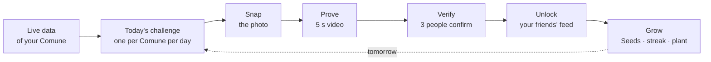

| | Step | What happens |
| :---: | --- | --- |
|  | **Today's challenge** | Every morning everyone in a Comune gets **the same challenge**, built from that Comune's live data and stored on the shared backend. Poor air → *Leave the car. Own the street.* Unlike BeReal there is no random alarm: you post when you actually do it. |
|  | **Snap** | A photo of the thing: the bike, the bin, the refill bottle, the plant. |
|  | **Prove** | A 2–5 second video of the act itself, played inside the photo as an inset tile. |
|  | **Verify** | People who can see your proof (your Comune or the group you chose) check it. **3 verifications** make it *Verified*. You can't verify your own. |
|  | **Post yours to see theirs** | Today's feed stays blurred until you've done your own green act. |
|  | **Grow** | Seeds, a streak, Agenda 2030 goals and a plant that grows from seed to bloom. Never a rank in your face. |

## Features

<table>
<tr>
<td width="25%" align="center">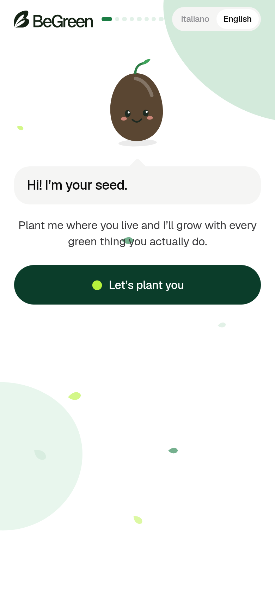<br><sub><b>Plant your seed</b></sub></td>
<td width="25%" align="center">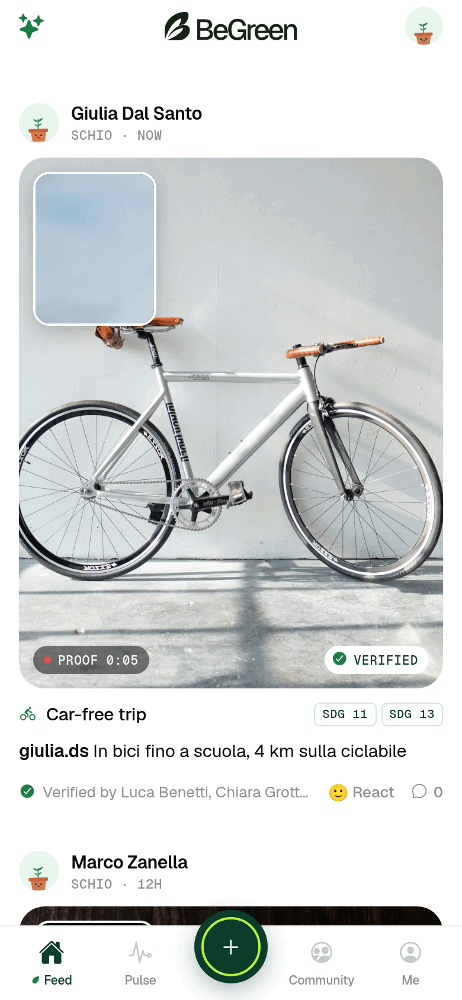<br><sub><b>Feed</b></sub></td>
<td width="25%" align="center">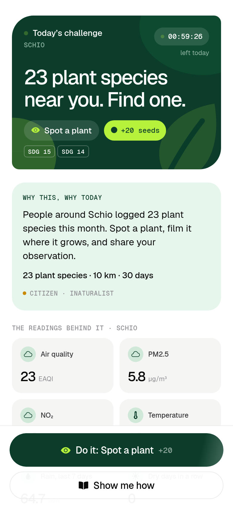<br><sub><b>Today's challenge</b></sub></td>
<td width="25%" align="center">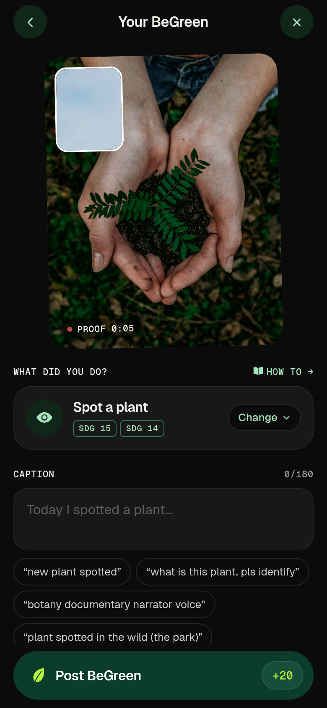<br><sub><b>Snap → Prove</b></sub></td>
</tr>
<tr>
<td width="25%" align="center">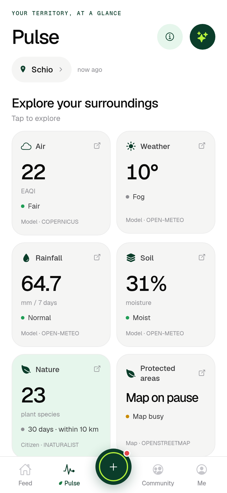<br><sub><b>Pulse: local data</b></sub></td>
<td width="25%" align="center">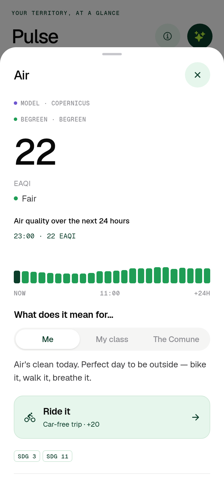<br><sub><b>Explained for me, my class, the Comune</b></sub></td>
<td width="25%" align="center">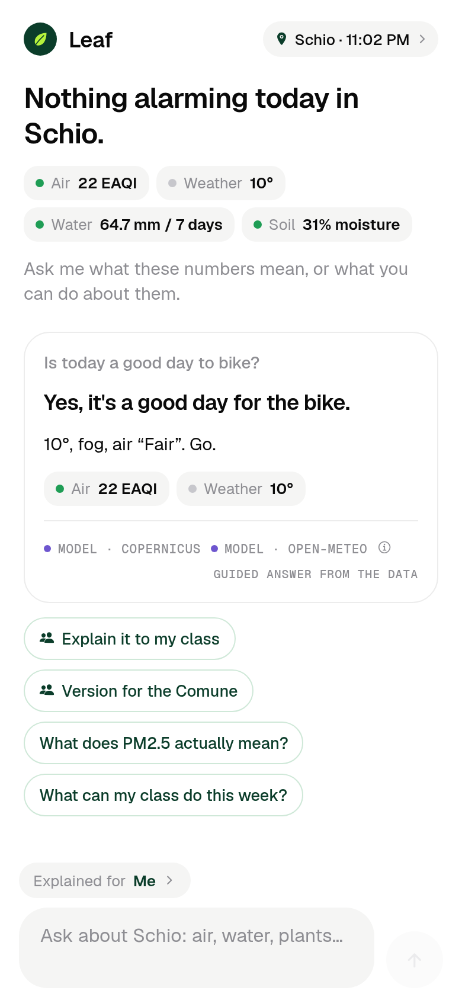<br><sub><b>Leaf: answers with sources</b></sub></td>
<td width="25%" align="center">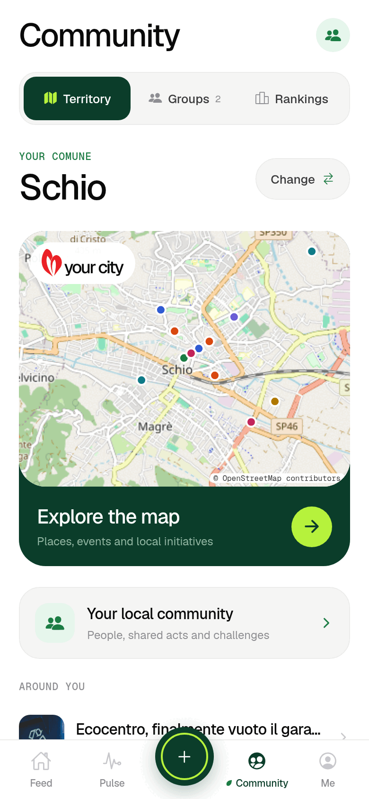<br><sub><b>Community: territory</b></sub></td>
</tr>
<tr>
<td width="25%" align="center">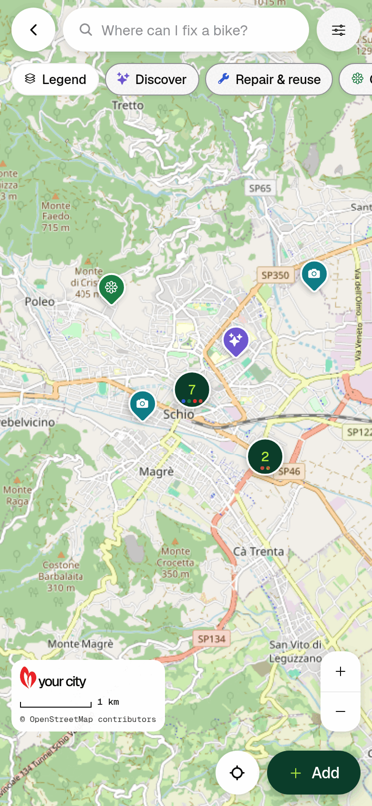<br><sub><b>A map the community builds</b></sub></td>
<td width="25%" align="center">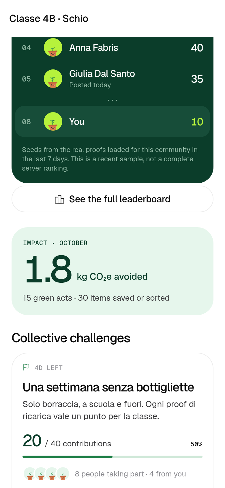<br><sub><b>Groups: classes, friends, crews</b></sub></td>
<td width="25%" align="center">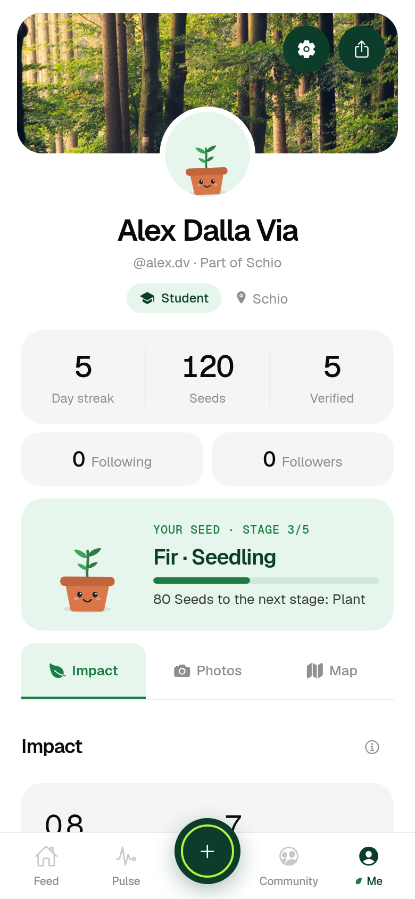<br><sub><b>Me: plant, impact, Agenda 2030</b></sub></td>
<td width="25%" align="center">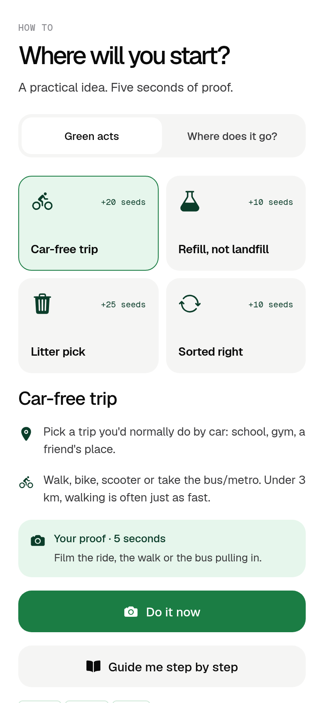<br><sub><b>How to & where it goes</b></sub></td>
</tr>
</table>

###  Plant your seed (onboarding)

Your seed, a little buddy with a face, asks one thing at a time: where to plant it (your position or a search), then shows **the live ground of that Comune** (air, rain or dry days, soil moisture, each with its source) and reacts to it, while today's challenge opens like a bud. Then name, @handle (checked while you type, with free alternatives), role (student, teacher, association, Comune) and species (sunflower, oak, lavender, poppy, tomato, fir). *Hold to plant* creates an anonymous account: no email, no password. The camera permission is explained before the phone asks. Reduce Motion turns animations into fades; hold-to-plant becomes a tap for screen readers.

###  Feed

One daily card with today's challenge, a countdown, your streak, how many people in your Comune already did it and your own proof (with its verification progress), then an entry to Community. Lenses: **All · Friends · Groups · your Comune**. Group proofs appear only in the group they were shared to. When a Comune is still quiet, example proofs fill the feed, always labelled **DEMO**, never verifiable or counted. Your own posts have a **⋯** menu to delete them everywhere.

###  Capture: Snap → Prove → Review → Celebrate

Photo, then a 2–5 second proof, then review. You choose where it goes: **your Comune, Everyone or one group** (a missing group blocks submission instead of publishing elsewhere). The celebration shows Seeds, streak, contribution and Agenda 2030 goals, plus the new plant stage if your seed grew. On a simulator or on the web there's no camera, so **library** and **demo** capture let you try the whole flow.

###  Pulse: your Comune's data

Six compact cards (**air, weather, rainfall, soil, plant observations, protected areas**). Each one opens a detail sheet with animated, selectable charts, photos or nearby areas, **Me / My class / Comune** explanations, sources and limits, and the action it links to. Each source loads separately, so one outage never empties the screen; missing sources stay visible with a retry.

###  Leaf: the assistant that cites its sources

Leaf opens on one line about today in your Comune, today's numbers as chips and up to three questions picked from the data (problems first). Every answer is a card: a verdict, a short explanation, the numbers, **the sources it used** and whether it is a guided or an AI answer. *Explained for* switches between Me, My class and the Comune; follow-up chips re-ask for another audience. It never invents a value. [More on Leaf ↓](#leaf-the-ai-layer)

###  Community: territory, groups, rankings

- **Territory:** the Comune you picked, a large preview of the full-screen map, local people and recent contributions.
- **The map is real:** OpenStreetMap down to street level, with BeGreen pins in seven layers: *discover, repair & reuse, gardens & groups, swap & share, events & challenges, reports, moments*. Search understands questions (“Where can I fix a bike?”, “events this weekend”) and finds real streets; filters, legend, clustering and directions.
- **Add a place** in five photo-first steps (what, photo, words, where, who sees it). Exact public spots need explicit confirmation; any spot can be approximate (~200 m).
- **Trust tools:** “out of date”, “wrong”, “not OK” and “looks fixed” flags, corrections, author blocking, moderators who verify, hide or delete. Nobody's real-time position is ever shown.
- **Groups** for friends, classes, associations and crews: public or private, joined with an invite code. Each group has goals, an impact report as one big number (kg CO₂e avoided, acts, items) and an inline weekly leaderboard.
- **Challenges** with a goal and a deadline (discover 5 places, organise a swap, clean up a neglected corner…), a thank-you list instead of a ranking, plus one optional **daily prompt** for everyone, no streak.
- **Rankings** are secondary and opt-in: the Comune or one of your groups, from recent proofs, clearly labelled as a sample.

###  Friends

Follow anyone: the accounts you follow are your friends. Profiles show Follow / Following / Follow back, counts and a photo grid. Search by name or @handle, with suggestions from your groups and Comune. Friends' proofs appear in the *Friends* lens and in the map's “from friends” filter.

###  Me

Your seed's plant (seed → sprout → seedling at 60 Seeds → plant at 200 → bloom at 500; it never shrinks, it only looks thirsty when the streak breaks), streak, Seeds, verified proofs, followers. Three tabs:

- **Impact:** estimated kg CO₂e, items, litres and nature records (always labelled as estimates), the **Agenda 2030** grid with the countdown to 1 January 2030, and six **badges** with progress rings, one of which you can wear as a title.
- **Photos:** a grid of your proofs.
- **Map:** the areas of your proofs (the Comune centre, never the exact spot).

Settings: edit profile and seed, light / dark / system theme, explanation audience, Comune, **Italian / English**, saved places, guide, sources, Leaf.

###  How to & How we know

- **How to:** a card for each of the ten green acts with an optional three-step walkthrough, and a **“Where does it go?”** lookup for six materials with examples.
- **How we know:** what each kind of source is (official, model, citizen science, open map, community), what it's good for and where to be careful. Data whose access or licence still needs checking is flagged ⚠︎.

### The ten green acts

| Act | Areas | Agenda 2030 | Estimated impact |
| --- | --- | --- | --- |
|  Car-free trip | mobility, air | SDG 11 · 13 · 3 | 0.8 kg CO₂e |
| Sorted right | consumption, soil | SDG 12 · 11 | 1 item |
|  Litter pick | soil, water, nature | SDG 14 · 15 · 11 | 5 items |
| Refill, not landfill | consumption, water | SDG 12 · 6 | 1 item |
|  Plant something | soil, nature, air | SDG 15 · 13 | 0.25 m² |
| Spot a plant | nature | SDG 15 · 14 | 1 record |
| Zero-waste plate | consumption | SDG 12 · 2 · 13 | 0.5 kg CO₂e |
| Thrift / repair | consumption | SDG 12 · 8 | 1 item |
| Save water / energy | water, air | SDG 6 · 7 · 13 | 20 litres |
| Group action | community | SDG 17 · 11 · 4 | 10 items |

<sub>Impact figures are conservative per-act estimates (`src/data/actions.ts`) and are labelled that way everywhere in the app.</sub>

## Built for the brief

BeGreen answers **Track 2, “La mia sostenibilità”** of the [Good Vibes / FESAV 2026](docs/regolamento.md) civic hackathon. The guiding question: *how do we turn the environmental data of our territory into decisions and actions within reach of whoever has to take them?*

| Brief requirement | Where it lives in BeGreen |
| --- | --- |
| Person / class / association / Comune scale | Roles in onboarding, group types, **Me / My class / Comune** explanations in Pulse and Leaf |
| Starts from the local environment | Pulse and today's challenge, from the Comune the user picks (GPS only suggests it) |
| Links knowing to doing | Every Pulse card ends in an action; today's challenge turns the worst indicator of the day into a mission |
| Air, water, soil, biodiversity, consumption, mobility, community | Six Pulse cards and ten acts, each tagged with the areas it touches |
| Protected areas, species, nature observations | iNaturalist and GBIF species with photos and attribution; protected areas from OpenStreetMap |
| Air quality, weather, local climate | CAMS European AQI with a 24 h chart and dominant pollutant, citizen PM2.5 sensors, ARPAV PM10 stations, weather and rain |
| Soil and landscape | Soil moisture and its trend; ISPRA land sealing per Comune |
| Individual behaviour and group activity | Personal proofs, group goals and impact, community challenges |
| AI to understand data and documents | **Leaf** explains raw numbers in plain language and plugs into an LLM backend |
| Answers that cite sources | Every Leaf answer and every Pulse card carries its source badges |
| Image interpretation | Photo + video proofs verified by peers today; the backend contract covers species ID and proof checks |
| Sources aren't equivalent | Five colour-coded source kinds; each card names its limits (e.g. “model, ~10 km grid, not an ARPA station”) |
| Agenda 2030 | Every act and every Pulse card is tagged with the SDGs it touches; the profile counts goals covered |

### Against the jury criteria

| Criterion | Our answer |
| --- | --- |
|  **Coherence** | One loop from local open data to a concrete act, verified by real people, at the scale of a person, a class, an association or a Comune. |
|  **Innovation** | Not an eco dashboard: a social app whose currency is verified green acts. One shared challenge per Comune per day, proof video, peer verification, a map built by the community, an assistant that cites its sources. |
|  **Real sustainability** | No API keys and no paid data: open sources plus Expo and Supabase. Growth city by city and school by school; free for teens, with a paid tier for schools and Comuni and only vetted, verifiable sponsored challenges ([MARKETING.md](MARKETING.md)). Impact is counted in verified acts, never overclaimed. |

## Open data & AI

### Data sources: no API keys

| Domain | Source | Kind |
| --- | --- | --- |
| Air quality (EAQI, PM2.5, PM10, NO₂, O₃, 24 h forecast) | Copernicus CAMS via Open-Meteo |  |
| Weather, rain over the past 7 days and next 3, soil moisture | Open-Meteo |  |
| Species seen within 10 km in the last 30 days (research grade) | iNaturalist API |  |
| Species recorded within 5 km in the last 5 years | GBIF API |  |
| Citizen PM2.5 sensors within 10 km (median of the latest readings) | Sensor.Community |  |
| Protected areas and nature reserves within 25 km | OpenStreetMap via Overpass |  |
| Italian Comuni (search, coordinates) | Open-Meteo geocoding (GeoNames) |  |
| PM10 annual mean and exceedance days per station (2025), emissions per Comune (INEMAR 2019) | ARPAV open data (bundled CSV extract) |  |
| Land sealed per Comune (2024), separate waste collection per Comune (2024) | ISPRA / SNPA, ISPRA Catasto Rifiuti (bundled extract) |  |
| Acts, challenges, places | BeGreen (aggregated, anonymised) |  |

Official per-Comune data is a bundled extract for the **Province of Vicenza**, matched to the Comune you picked by name (or the nearest centroid). Datasets, joins and thresholds: [`docs/dati-comune.md`](docs/dati-comune.md). If everything is offline the app shows clearly labelled sample data, and a challenge built from sample data is never saved as the Comune's challenge.

### Leaf: the AI layer

`src/services/leaf.ts` has two modes:

- **Grounded local engine (default):** recognises the intent of the question and answers using only the live Pulse numbers. It never invents a value, always cites sources and works offline, in Italian or English.
- **AI backend:** set `EXPO_PUBLIC_LEAF_ENDPOINT`. That server is where a language model reads documents, interprets proof images, identifies species and rewrites answers for the audience. **Model keys stay on the server, never in the app.** If the backend fails, the app falls back to the local engine.

<details>
<summary><b>Leaf backend contract</b></summary>

<br>

The app sends:

```json
POST { "question": "…", "audience": "me | class | comune", "language": "it | en", "pulse": { }, "insights": [ ] }
```

and expects:

```json
{ "text": "…", "cites": ["cams", "openmeteo"], "headline": "…", "facts": [{ "label": "PM2.5", "value": 18, "unit": "µg/m³", "level": "fair" }], "followUps": ["…", "…"] }
```

`headline`, `facts` and `followUps` (up to two) are optional; unknown sources and malformed fields are dropped. If the backend ignores `language`, the local engine answers in the active language.

</details>

## Run it

> [!NOTE]
> Requires Node.js 24 (as in CI) and npm. The app runs in **Expo Go**, no native build needed for the demo.

```bash
git clone https://github.com/xFurti/BeGreen.git
cd BeGreen
npm install
npx expo start            # i = iOS simulator · a = Android · scan the QR code with Expo Go
```

**Local web preview without any backend** (everything stays in the browser):

```bash
EXPO_NO_DOTENV=1 npm run web -- --port 8092
```

### Shared feed between phones (Supabase)

1. Create a Supabase project (or run `npx eas-cli@latest integrations:supabase:connect`), then in **Authentication → Sign In / Providers** enable **Allow anonymous sign-ins**.
2. Apply the schema: `npx supabase link --project-ref <ref>` and `npx supabase db push`.
3. Copy `.env.example` to `.env.local` and fill in the public values:

   | Variable | Required | What |
   | --- | :---: | --- |
   | `EXPO_PUBLIC_SUPABASE_URL` | for sharing | Project URL (Project Settings → API) |
   | `EXPO_PUBLIC_SUPABASE_PUBLISHABLE_KEY` | for sharing | Publishable key, public by design: RLS protects the data |
   | `EXPO_PUBLIC_LEAF_ENDPOINT` | optional | Your AI backend for Leaf |
   | `GOOGLE_MAPS_API_KEY` | optional, build time | Restricted Maps SDK key for the native Android profile map |

4. Restart `npx expo start`. Two phones (or a browser and a private window) now share today's challenge, the feed, groups and the map.

> [!IMPORTANT]
> Never put a secret or service-role key in the app. Without the two Supabase variables BeGreen still runs, on this phone only.

### Maps

The community map uses OpenStreetMap tiles and Photon search everywhere. The profile map uses **Expo Maps** in a development build (Apple Maps from iOS 18; Google Maps on Android with a Maps SDK key), and a static tile preview in Expo Go. Details: [`docs/profile.md`](docs/profile.md).

### Checks

```bash
npm run verify            # typecheck + lint + tests (workflows, i18n, services, Supabase migrations and RLS)
```

The same command is the `Verify` check in CI. Database tests run every migration on an in-memory Postgres ([PGlite](https://pglite.dev)) and check row level security.

## Architecture

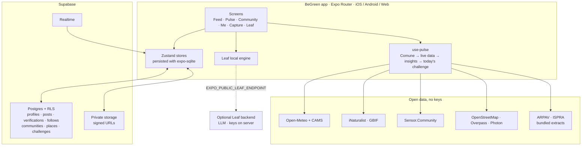

<details>
<summary><b>Shared backend: rules enforced in the database</b></summary>

<br>

- **Accounts** are anonymous Supabase users with a public name and handle. You write only your own rows, can't verify your own proof, can't claim the same challenge twice; group totals are maintained by the database, not by the app. Deleting your post cascades to its verifications, reactions and comments.
- **Today's challenge** is one row per Comune per day (`<comune id>:<date>`). The first phone that opens the app that day builds it from the Comune's live data; everyone else reads the same row. Every phone writes the title in its own language from the same stored readings.
- **Media** live in the private `proofs` bucket, one folder per user, read through five-minute signed URLs. Photos are JPEGs up to 1280 px, clips are 480p when supported.
- **Live updates:** the feed refreshes when someone posts, verifies, reacts or comments.
- **Community:** cities and groups, places, flags (with auto-hide), saves, events, challenges, blocks and `join_by_code`, all with RLS.
- **Follows:** anyone signed in can read them; only you can add or remove your own.

Migrations: [`supabase/migrations`](supabase/migrations) · tests: [`supabase/tests`](supabase/tests).

</details>

<details>
<summary><b>Migrating old squads to groups</b></summary>

<br>

`20261028000000_unified_groups.sql` copies existing squads into private groups with stable `squad:<uuid>` IDs, preserves memberships, join dates, posts and interactions, and keeps the old tables. Old invite codes remain valid aliases; ambiguous codes ask the person to choose. The `proofs` bucket becomes private, so **app and migration must be rolled out together after human approval**, after testing on a disposable copy. PGlite tests cover Postgres/RLS, not Supabase Storage HTTP or CDN behaviour. Legacy routes `/squad/:id`, `/new-squad` and `/league` redirect to the new screens.

</details>

<details>
<summary><b>Project structure</b></summary>

<br>

```
src/
  app/                     Expo Router routes (screens only)
    (tabs)/                Feed · Pulse · Community · Me + custom tab bar with the shutter button
    onboarding.tsx         Plant your seed
    capture.tsx            Snap → Prove → Review → Celebrate
    drop.tsx               Today's challenge and the readings behind it
    leaf.tsx               Leaf assistant
    sources.tsx            How we know
    guide.tsx              How to · Where does it go?
    comune.tsx             Comune search
    post/[id].tsx          Proof detail, verifiers, comments
    friends.tsx member/[id].tsx    Follows, search, profiles
    community/[id].tsx     City or group page · community-ranking.tsx
    map/[id].tsx spot/[id].tsx add-spot.tsx flag-spot.tsx saved.tsx
    communities.tsx new-community.tsx join.tsx new-challenge.tsx
    squad/[id].tsx new-squad.tsx league.tsx   Legacy redirects
  components/              UI kit, logo, nature motifs, cards, map, badges, onboarding steps, guide
  data/                    Acts, badges, seeds, SDGs, sources, waste guide, Comuni, demo media
  hooks/                   use-pulse, use-social, use-comune, use-community-feed…
  i18n/                    Italian / English catalogs, locale detection and persistence
  services/                env (live APIs), drop, challenge, leaf, social, community, follows, media…
  store/                   app-store and community-store (Zustand)
  theme/                   Colour tokens, Geist families, radii, type scale
supabase/                  Migrations (schema, RLS, triggers, bucket) and their tests
tests/                     Unit tests (badges, seeds, rewards, media, theme…)
assets/                    Icon, splash, demo photos (Unsplash), 5 s proof clips
docs/                      Track, rules, decisions, data notes, screenshots
```

</details>

## Brand & design system

<table>
<tr>
<td width="140" align="center">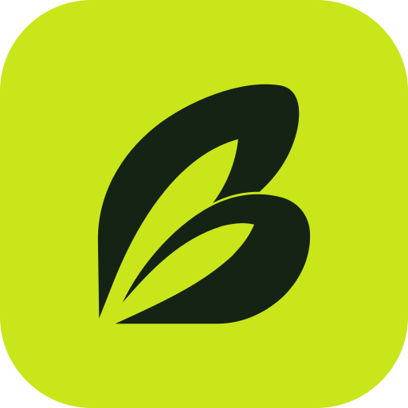</td>
<td>


</td>
</tr>
</table>

<p align="center">
  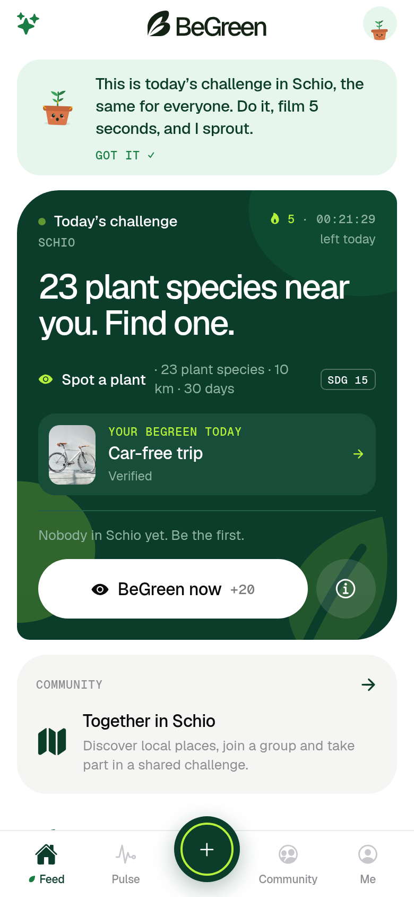
  &nbsp;&nbsp;
  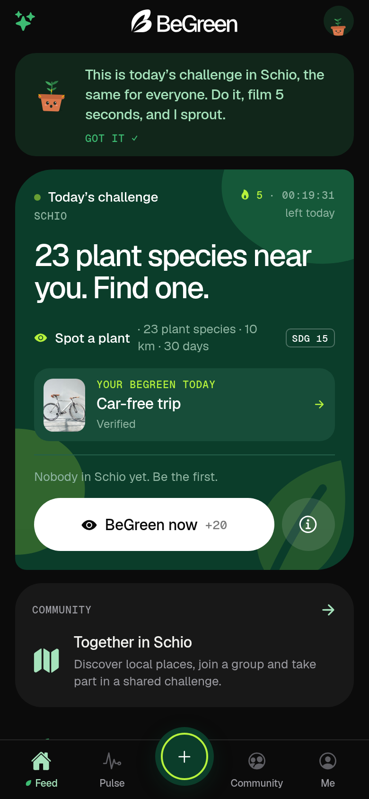
</p>

- **White paper, black ink, one living green.** Proof Lime and Canopy for the logo, icon and splash; in the app a green family (`forest`, `leaf`, `lime`, `mint`) in `src/theme/tokens.ts`. Data keeps its own signal colours (air bands, source kinds, recording red). Light and dark themes.
- **Logo:** the leaf “B” mark and lockup from the BeGreen Brand Kit v1.0, drawn as vectors in `src/components/logo.tsx`. Never lime on white (1.4:1), never stretch, rotate or rearrange; minimum 88 px wide for the lockup, 16 px tall for the mark.
- **Type:** Geist for headlines and body, **Geist Mono** for metadata and numbers (`SDG 13`, `PROOF 0:05`). The brand book adds Funnel Display for marketing headlines.
- **Nature motifs:** a sprout for empty states, drifting organic blobs, a switch that sprouts a leaf, leaves flying out when you verify, leaf confetti on the celebration. Decorative and hidden from screen readers.
- **Feel:** editorial layout, hairline rules, big tabular numbers, haptics on every meaningful press, springs on entry. Reduce Motion is respected everywhere.
- **Voice:** short, dry, a little funny. We celebrate doing, never shame not-doing. Honest about data: “model”, “estimate”, “citizen science”.

## Go-to-market

<div align="center">
<picture>
  <source media="(prefers-color-scheme: dark)" srcset="docs/readme/brand/love_your_city_white.svg">
  
</picture>
</div>

The strategy is a journey from scrolling to the street:

| | Stage | The hook | In BeGreen |
| :---: | --- | --- | --- |
|  | **1. Get them in** | *“Finally, sustainability isn't boring.”* Relatable, funny posts people send to friends. | Social channels; shareable proofs. Someone downloads BeGreen without thinking of themselves as an environmentalist. |
|  | **2. The daily ritual** | *“What did everyone do today?”* | Today's challenge, *post yours to see theirs*, the daily prompt. Missing a day is never a failure. |
|  | **3. The real-world game** | *“Let's see what we can change in our city.”* | Groups, classes and neighbourhoods take on challenges: a reuse spot, a clean-up, a repair shop. |
|  | **4. The city becomes yours** | *“Your city, through the eyes of your community.”* | The community map: places, events and reports discovered through friends, not sponsored results. |

Growth is **school by school, city by city**, because network effects are local: launch schools and student ambassadors in one seed city, a Comune that presents the results next to real air-quality data, then the next city. North-star metric: **verified green acts per week**. Full plan, segments, metrics and business model: [MARKETING.md](MARKETING.md).

## Honest limits

> [!WARNING]
> This is a hackathon prototype. Here's what it doesn't do yet.

- **Anonymous accounts** tied to the phone: signing out or reinstalling loses the account (your proofs stay on the feed). Linking email / Apple / Google is in the backlog.
- **Today's challenge** is built by the first phone that opens the app in a Comune that day. The database checks its shape and date, not its numbers; a server-side job would make it tamper-proof.
- **Proof moderation** is basic: “Flag proof” only asks for confirmation. Places have flags, auto-hiding and moderators, but promoting moderators beyond a group's founder is done in the database. Verifications are one per person, not yet checked for proximity or fraud.
- **Leaderboards and counts** use downloaded proofs, not complete server-side aggregates, and say so.
- **Impact figures** are conservative per-act estimates, labelled as such.
- **Map search** for BeGreen places is an offline keyword and intent matcher, not a language model. Tiles and street search rely on free OpenStreetMap / Photon services meant for light use; production needs a keyed tile provider.
- **Official data** (ARPAV, ISPRA) is a bundled extract for the Province of Vicenza; the ISPRA Catasto Rifiuti reuse licence is still marked “to verify”.

Ideas for after the hackathon: [`docs/ideas.md`](docs/ideas.md).

## Team

 **Magilla Gorilla**: six students from the **Liceo Tecnologico Guglielmo Marconi** in Verona, at **Good Vibes / FESAV 2026** (Schio, 22–24 October 2026).

| Class | Members |
| :---: | --- |
| **4AI** | Holovan Oleksii · Vitiello Lorenzo |
| **4BI** | Bassanello Leonardo · Cremonese Luca · Warnakulasuriya Arachchilage Fernando Nipun Samuel |
| **4SI** | Cipriani Gabriele |

## Contributing

 The repo's working rules live in [AGENTS.md](AGENTS.md); they apply to AI assistants too. The short version:

- Branch from an up-to-date `main` (`feat/12-demo`, `fix/18-login`, `docs/pitch`) and open a PR to `main`. `npm run verify` must pass.
- Another teammate approves before merging. When Pi review is configured in CI, it runs on its own on ready PRs.
- Tasks and owners: [docs/team.md](docs/team.md) · new ideas, off the current scope: [docs/ideas.md](docs/ideas.md).

### Documentation

| Document | What |
| --- | --- |
| [docs/traccia.md](docs/traccia.md) · [docs/regolamento.md](docs/regolamento.md) | The official track and the event rules |
| [docs/presentation.md](docs/presentation.md) | Pitch structure and demo path (8 minutes) |
| [docs/decisions.md](docs/decisions.md) | Why the product looks like this |
| [docs/dati-comune.md](docs/dati-comune.md) | Official per-Comune datasets, joins and thresholds |
| [docs/profile.md](docs/profile.md) | Profile and native map setup |
| [MARKETING.md](MARKETING.md) | Go-to-market plan |
| [skills/](skills/) | Optional agent skills: track, feature, review, pitch |

## Credits

Environmental data from **Copernicus CAMS**, **Open-Meteo**, **iNaturalist**, **GBIF**, **Sensor.Community**, **ARPAV** and **ISPRA / SNPA**. Maps © **OpenStreetMap** contributors (ODbL), street search by **Photon** (komoot). Demo photos from **Unsplash**. Icons in this README: **Ionicons** (MIT), the same set the app uses. Nature micro-interactions inspired by [uiverse.io](https://uiverse.io) and [React Bits](https://reactbits.dev).

<div align="center">
<br>
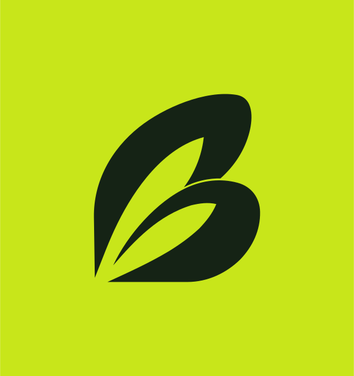
<br>
<sub><b>BeGreen</b> · Love your city. Show it. · Proof, not promises.</sub>
</div>
