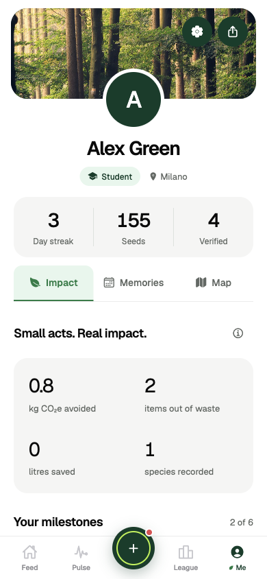
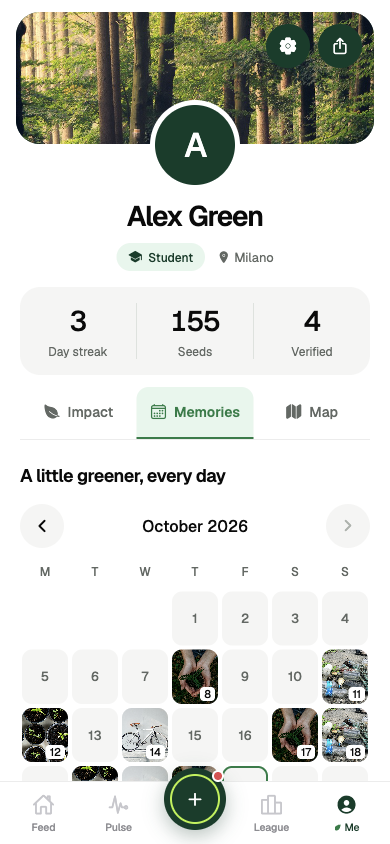
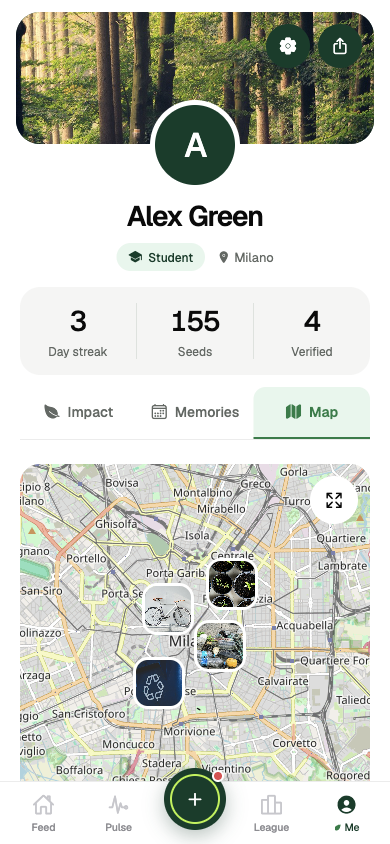

# User profile

> Draft UI concept for team feedback. The layout, milestones, demo history and sample map positions are illustrative. Before integration, reconcile this branch with the newer shared profiles/auth, badge/title and language work on `main`, and review open Me-related PRs (#25, #40, #41, #54). This proposal does not define the final data model or replace those implementations.

The Me screen follows the centre profile in the [Playora reference by Ryan Indra / Semusim Team](https://dribbble.com/shots/27457522-Playora-Sports-Mobile-App-Profile-Setting-Page): a photo cover, an overlapping avatar, centred identity, compact statistics and three content tabs. BeGreen keeps its existing Geist typography and green, white and black palette. The avatar has a white edge against the cover; the lime ring is removed.

- **Impact:** estimates from proofs with at least three friend verifications and milestones. Earned milestones have a green background; the others share the same neutral style. Status captions are omitted. An information icon beside the title opens the sources and counting explanation; there is no verified-count label or Agenda 2030 grid.
- **Memories:** a Monday-first calendar with month navigation, day filtering and photo cards that open the original proof. Each photo carries its date at the bottom left and, once verified by three friends, a green check at the top right. The action name stays below the photo, without pending-verification captions. Multiple proofs on one day remain accessible.
- **Map:** only a map, photo markers and an icon over the map to open it fullscreen. There are no headings, descriptions or places list. Tapping a photo opens its existing post; fullscreen has a close icon and retains the map camera. Native development builds use `expo-maps`: Apple Maps on iOS and Google Maps on Android. Web uses Leaflet with OpenStreetMap tiles and attribution.

The cover holds the settings and share icons. Settings include Edit profile, which saves name, username and role in the existing local persisted store. Usernames use 2–24 letters, digits or underscores; they are local demo identifiers, with no server-side uniqueness check. Settings also contain the explanation audience, guide, sources, Leaf and a confirmed reset of local demo data.

The profile header displays the name and role without an @username tag. All three profile tabs omit the BeGreen slogan footer.

New proofs save coordinates rounded to two decimal places (roughly 1 km) only when the existing Share area control is enabled. Historical posts without coordinates stay in Memories; the map does not infer coordinates from a city name or the user’s current location. Until there is a non-demo post with a shared area, four existing seed posts are shown at distinct sample positions in Milano. These demo positions are presentation data and are never saved as personal post locations. Expo Go shows a static compatibility preview with the same photo links and fullscreen control. Expo Maps requires a new native development build; annotation taps on iOS require iOS 18 or later. Android development/store builds also require a Google Maps SDK key via `android.config.googleMaps.apiKey` in the build configuration; no key is added to the repository.

The forest cover is the existing bundled `assets/demo/forest.jpg`. Profile and social data remain local prototype data.

## Concept preview

Mobile web captures (390 × 844), using the branch's demo history:

| Impact | Memories | Map |
| --- | --- | --- |
|  |  |  |

To try the concept: `npm ci`, `npm run web`, skip the onboarding story, enter a name and keep Demo history enabled, then open **Me**. The web route is `/me`. Native map builds have not been verified.

Verification:

```bash
npm run verify
node --test tests/profile.test.cjs
```

The targeted tests cover profile input validation, leap years and calendar boundaries, multiple proofs per day, missing/invalid coordinates, demo pin selection, map camera framing, tile coverage and date-line wrapping.
